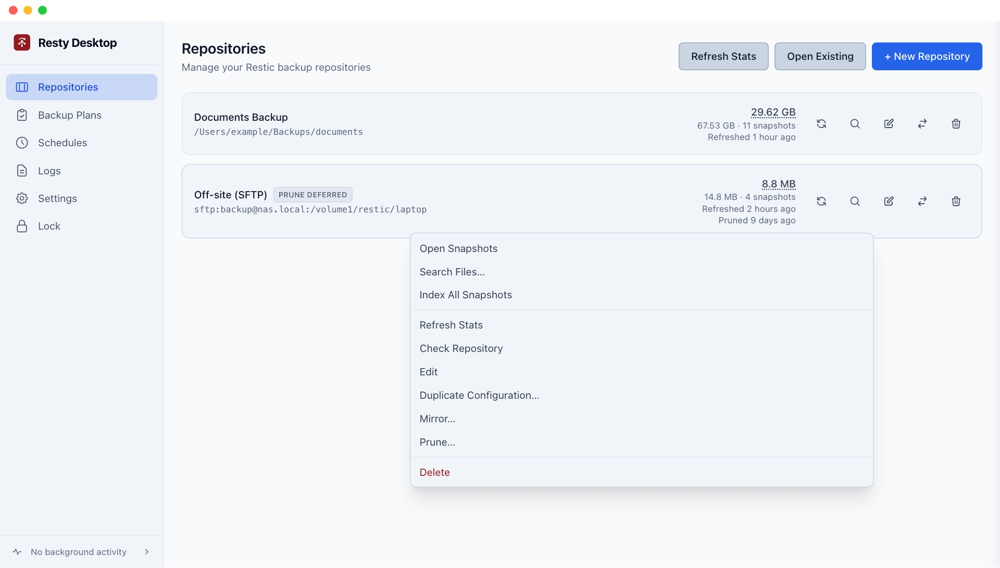
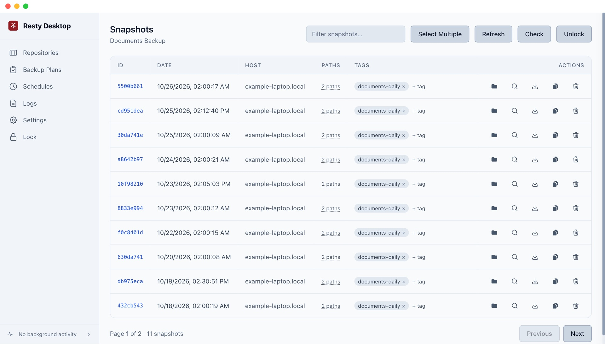
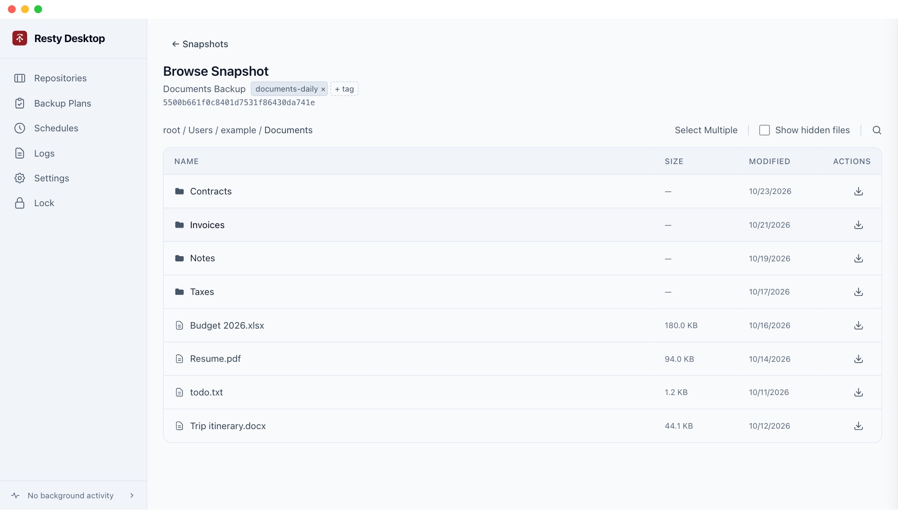
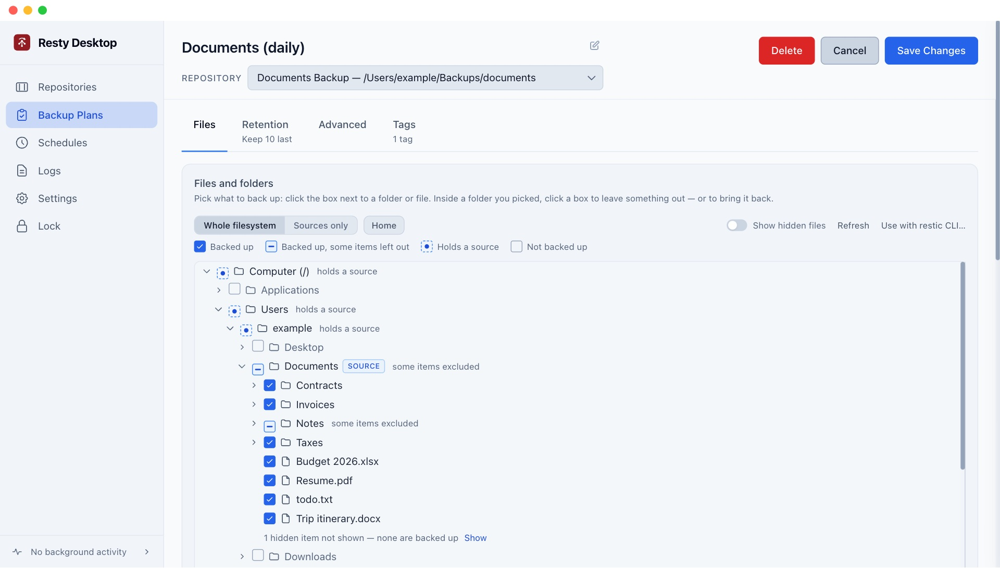
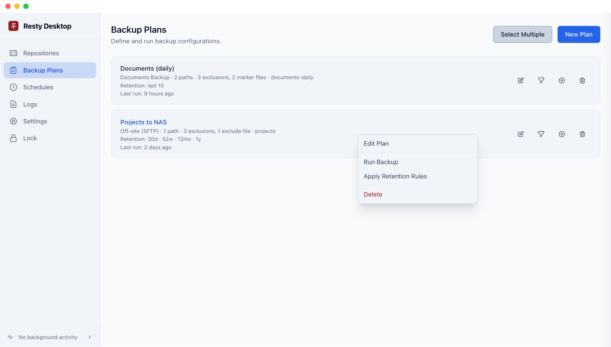
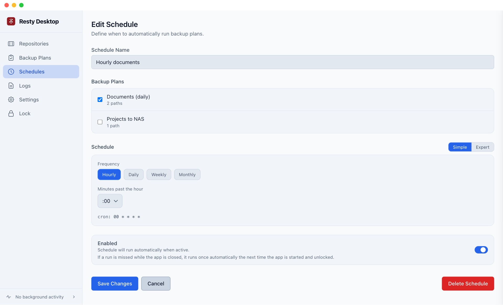
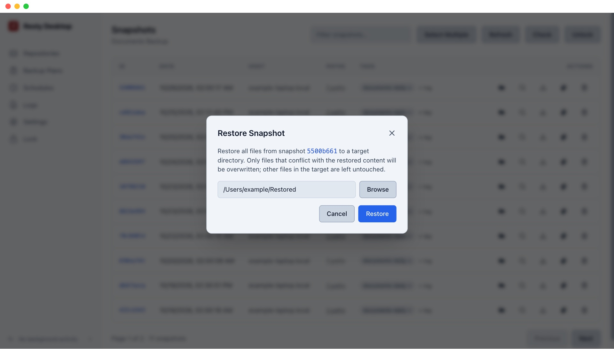
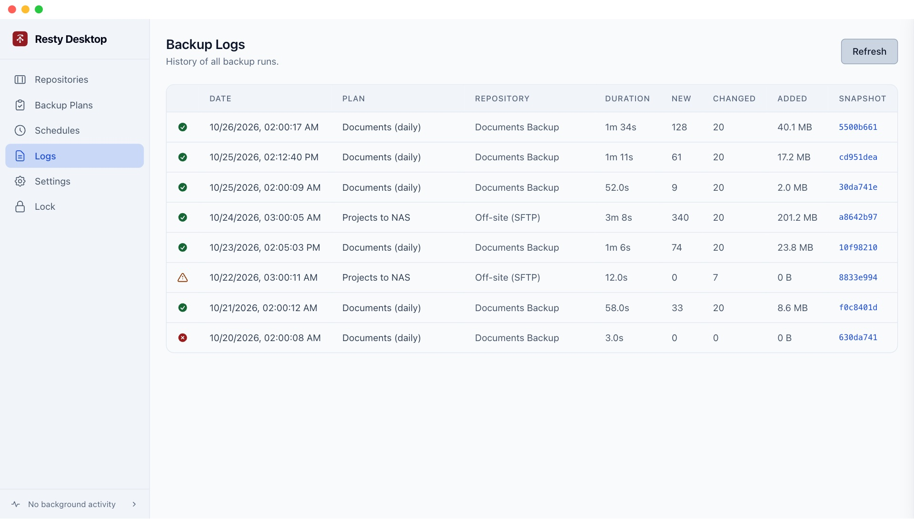
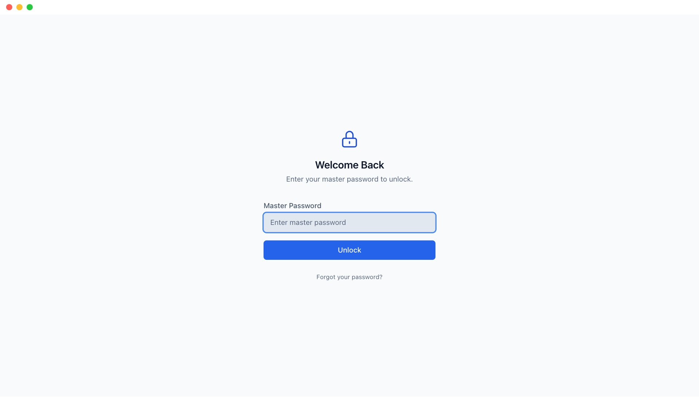

# Resty Desktop

A cross-platform desktop client for [Restic](https://restic.net/), the fast and secure backup tool. Resty Desktop wraps the Restic CLI to provide a visual interface for managing repositories, creating backups, browsing snapshots, and restoring files — without touching the command line.

## Screenshots

| | | |
|:---:|:---:|:---:|
|  |  |  |
| List Repositories | List Snapshots | Browse Files within Snapshots |
|  |  |  |
| Define Backup Plans | List Backup Plans | Schedule Backups |
|  |  |  |
| Restore Snapshot | Backup History | Unlock Application |

## Features

- **Master password** — all repository passwords are encrypted at rest; a single master password unlocks the app on each launch
- **Auto-unlock** (macOS / Windows; Linux best-effort via the Secret Service) — an opt-in, off-by-default toggle that stores the derived unlock key (never your master password) in the OS credential manager, so the app can unlock itself at startup instead of showing the password prompt. Trade-off worth knowing: anyone with access to your unlocked desktop session can then open Resty and use every repository, since the OS credential store is scoped to your user account, not to this app specifically
- **Repository management** — add local or remote repositories (Amazon S3 / S3-compatible, native Backblaze B2, a restic REST server, SFTP, and other restic-supported backends), initialize new ones, check integrity, rename, remove, or mirror to another repo
- **Read-only repositories** — mark a repository backed by a genuinely read-only filesystem or mount as read-only; the app opens it with restic's own `--no-lock` for every read, and refuses writes (backup, prune, tag, delete, retention) outright rather than relying on restic to reject them
- **Launch at login** — optionally have the OS start the app automatically at login (uses the native macOS LaunchAgent / Windows Registry Run entry / Linux XDG `.desktop` mechanism), gated on the system tray toggle since without the tray, closing the window quits the app
- **Backend credentials** — optionally store credentials (e.g. S3 access keys, native B2 application keys, REST server username/password) per remote repository, encrypted with the master password; left blank, restic falls back to your system's own credential chain (`~/.aws/credentials`, an IAM role, etc.) exactly as before. Note: restic's own documentation recommends B2's S3-compatible API over its native backend for better error handling
- **Backup plans** — a tabbed editor (Files, Retention, Advanced, Tags) built around a file tree. It starts at the whole filesystem: click a folder to back it up, click inside it to leave something out or bring it back, with undo. Every row shows whether restic would include it and which rule decided, using a port of restic's own matching rules that is tested against the real restic. Plans can also use path-list files (`--files-from`), exclude-pattern files, `--exclude-if-present` markers and cache-directory exclusion, and "Use with restic CLI…" turns a plan into the exclude files and `restic backup` command that reproduce it by hand
- **Retention** — keep-last/daily/weekly/monthly/yearly rules per plan, applied after each backup; an optional default policy in Settings pre-fills new plans, and a per-repository "prune after retention" switch leaves pruning to an explicit prune where deleting data costs money
- **Run on demand or on a schedule** — start a plan from the plan list, or attach it to a schedule (below)
- **Schedules** — attach backup plans to a cron schedule; runs happen in the background while the app is unlocked — with the system tray enabled, that includes while the window is closed
- **Snapshots** — browse all snapshots in a repository, add or remove tags, and delete one or several at once with optional pruning
- **Snapshot diff** — compare any two snapshots to see exactly what was added, removed, or modified, with per-entry restore directly from the diff view
- **File browser** — navigate the file tree inside any snapshot and restore individual files, directories, or entire snapshots
- **File search** — search by name or path across all files in a single indexed snapshot, or across every indexed snapshot in a repository at once; clicking a result opens the file browser at that location
- **Bandwidth limits** — optionally throttle upload and download speeds per backup plan for remote repositories
- **System tray** — optionally minimize to the system tray so scheduled backups continue running while the window is closed
- **Themes** — dark, light, and system appearance modes
- **Logs** — persistent history of every backup run with duration, file counts, bytes added, and snapshot ID
- **Warnings, not false failures** — a backup that saved its snapshot but couldn't read some files (restic exit code 3) is recorded as completed with warnings, listing the unreadable files and any source folder that no longer exists
- **Notifications and webhooks** — desktop notifications for backup start, success, warnings and failure (each can be muted), plus per-plan webhooks (generic JSON, Discord, Slack, Microsoft Teams, or your own template)
- **Activity panel** — a live view of background work: scheduled backups, indexing, stats refreshes, and mirrors
- **Import / Export** — export all repositories, backup plans, and schedules to a passphrase-protected file for backup or migration to another machine; import that file back, or import an existing [Backrest](https://github.com/garethgeorge/backrest) `config.json` to bring over its repos and plans

## Download

Pre-built binaries for macOS, Windows, and Linux are available on the [GitHub Releases page](https://github.com/nraboy/resty-desktop/releases).

## macOS Installation Note

Pre-built macOS binaries are not code-signed or notarized. macOS Gatekeeper will block the app with a "corrupted" warning on first launch. To allow it to run, remove the quarantine attribute after installing:

```bash
sudo xattr -rd com.apple.quarantine /Applications/Resty\ Desktop.app
```

## Requirements

- [Restic](https://restic.readthedocs.io/en/latest/020_installation.html) 0.17 or newer, installed and available on `$PATH` (or configured via Settings)
- [Rust](https://rustup.rs/) (for building from source)
- Node.js 20.19+ or 22.12+ (required by Vite 7)

## Getting Started

Install Rust if you haven't already:

```bash
curl --proto '=https' --tlsv1.2 -sSf https://sh.rustup.rs | sh
```

### Linux Prerequisites

Tauri v2 requires WebKitGTK and a few other system libraries on Linux. Install them before running `npm run tauri dev` or `npm run tauri build`.

**Debian / Ubuntu:**

```bash
sudo apt update
sudo apt install libwebkit2gtk-4.1-dev libssl-dev libayatana-appindicator3-dev librsvg2-dev patchelf xdg-utils
```

**Fedora:**

```bash
sudo dnf install gcc gcc-c++ make webkit2gtk4.1-devel openssl-devel libappindicator-gtk3-devel librsvg2-devel pango-devel
```

**Arch Linux:**

```bash
sudo pacman -S webkit2gtk-4.1 openssl libappindicator-gtk3 librsvg xdotool
```

Then install dependencies and start the development build:

```bash
npm install
npm run tauri dev
```

#### NVIDIA + Wayland

On NVIDIA + Wayland, Resty Desktop automatically detects that combination at launch and applies
a known WebKitGTK compatibility workaround for you — no environment variables needed for most
users. If you still hit a Wayland `Error 71` crash, or want to compare rendering behavior with
the workaround disabled, set:

```bash
RESTY_DISABLE_GPU_WORKAROUND=1 resty-desktop
```

If you hit a similar Wayland rendering crash on other hardware, the same workaround can be
applied manually:

```bash
WEBKIT_DISABLE_DMABUF_RENDERER=1 resty-desktop
```

## Building a Distributable

```bash
npm run tauri build
```

The packaged app will be written to `src-tauri/target/release/bundle/`.

## Stack

| Layer | Choice |
|---|---|
| Desktop shell | Tauri v2 |
| Frontend | React 19 + TypeScript |
| Styling | Tailwind CSS v3 |
| Build tool | Vite |
| Routing | React Router v6 |
| Rust backend | Tauri v2 `#[tauri::command]` |
| Settings persistence | SQLite (`app_data.db`) — repos, plans, schedules, encrypted passwords |
| Restic integration | `std::process::Command` with `--json` flag |

## Configuration

The Restic binary path defaults to `restic` on `$PATH`. You can override it in the Settings page if Restic is installed elsewhere.

The app automatically searches common installation locations (`/opt/homebrew/bin`, `/usr/local/bin`, etc.) when resolving binaries, so tools like `restic` and `rclone` installed via Homebrew or MacPorts should be found automatically even when the app is launched from Finder or a DMG.

## Support the Developer

This GUI wrapper for Restic was created by [Nic Raboy](https://www.nraboy.com). If you found it valuable, consider donating to demonstrate your appreciation.

- [PayPal](https://paypal.me/nraboy)
- [Sponsor on GitHub](https://github.com/sponsors/nraboy)

## Open Source & No Warranty

Resty Desktop is free and open source software, built and maintained in the developer's spare time. It's provided as-is, without warranty of any kind — the developer is not responsible for any loss or damage to your repositories or data that may result from using it. As with any backup tool, it's a good idea to verify your backups and test restores independently.

This is also a passion project rather than a supported product: there's no dedicated support channel, and the developer isn't able to offer personal, one-on-one help. Bug reports and contributions are always welcome through [GitHub Issues](https://github.com/nraboy/resty-desktop/issues) and pull requests.

## License

This project is licensed under the [MIT License](LICENSE).

## Special Note

AI was used in the development of this application. Resty Desktop is a GUI wrapper to the already existing and battle-tested Restic backup application. None of the heavy lifting happens in Resty Desktop, so AI or not, your data should be fine unless the underlying Restic application is faulty.